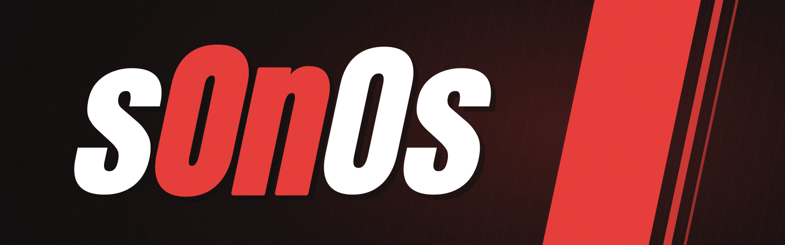

<p align="center">
  
</p>

<p align="center">
  <b>Plain Arch Linux. Nine questions to install.</b><br>
  An operating system for developers and gamers.
</p>

<p align="center">
  <a href="https://github.com/aOnurTheDev/sOnOs/releases"></a>
  
  
  
</p>

---

sOnOs installs a desktop with gaming support, the NVIDIA driver and, if you want them, complete development toolchains, on a plain Arch Linux that stays compatible with the official repositories and the AUR.

This repository is the [archiso](https://gitlab.archlinux.org/archlinux/archiso) profile that builds the sOnOs live ISO. The installer, **soninstall**, lives in [sOnInstall](https://github.com/aOnurTheDev/sOnInstall).

## Contents

- [Installing sOnOs](#installing-sonos)
- [Nine questions](#nine-questions)
- [What you get](#what-you-get)
- [The live ISO](#the-live-iso)
- [Building the ISO](#building-the-iso)
- [Contributing](#contributing)

## Installing sOnOs

| Step | |
|:---:|---|
| **1** | Download the latest ISO from [Releases](https://github.com/aOnurTheDev/sOnOs/releases). |
| **2** | Write it to a USB drive with Ventoy, balenaEtcher or `dd`. |
| **3** | Boot from the USB drive. soninstall starts by itself. |
| **4** | Answer nine questions, check the summary and confirm. |

<details>
<summary>The ISO comes in parts</summary>

GitHub limits release files to 2 GiB, so the ISO is split into parts named `sOnOs.iso.7z.001`, `sOnOs.iso.7z.002` and so on. Download every part into the same folder and extract the first one:

```shell
7z x sOnOs.iso.7z.001
```

On Windows, right-click `sOnOs.iso.7z.001` and extract it with [7-Zip](https://www.7-zip.org).

</details>

<details>
<summary>Writing the USB drive with dd</summary>

```shell
sudo dd bs=4M if=sOnOs-x86_64.iso of=/dev/sdX status=progress oflag=sync
```

`dd` erases everything on the target disk. Replace `sdX` with your USB drive and check it with `lsblk` first.

</details>

> [!TIP]
> No network cable? The installer offers to connect to Wi-Fi before it starts. You can also quit it, connect with `iwctl`, and run `soninstall` again.

## Nine questions

| | | | |
|:---:|---|:---:|---|
| **1** | Language | **6** | Desktop environment |
| **2** | Keyboard layout | **7** | NVIDIA driver |
| **3** | Username | **8** | Development tools |
| **4** | Password, also used for root | **9** | Disk |
| **5** | Time zone | | |

The installer continues in the chosen language, and the installed system gets it too. Everything else uses sensible defaults: NetworkManager, PipeWire, Bluetooth, zram swap and systemd-boot. A summary is shown before anything is written to the disk.

> [!NOTE]
> `nvidia-open` supports NVIDIA GPUs from the GTX 16 and RTX 20 series onward. With an older card, answer "no" to question 7; the open-source drivers are installed instead.

## What you get

| | |
|---|---|
| **Gaming** | Steam, GameMode, and Vulkan drivers (64- and 32-bit) for the GPU in the machine |
| **Desktop** | The environment you picked with its everyday apps, Firefox in your language, VLC, Blueman and pavucontrol |
| **Tools** | zsh, Neovim, Vim, micro, Git, fastfetch, btop and 7-Zip, plus the hardware, disk and network tools of the live ISO |
| **sOnOs** | The logo, wallpaper, `os-release` and fastfetch theme, kept across updates |
| **Development** *(optional, ~10 GB)* | C/C++ build tools, Visual Studio Code, Docker, embedded tools (Arduino, AVR, STM32), and compilers or runtimes for over 30 languages |

An installation takes about **7 GB**, or about **17 GB** with the development tools.

<details>
<summary>All development languages</summary>

Rust, Go, Python, Java, JavaScript/TypeScript, Ruby, PHP, Lua, Perl, Haskell, R, Elixir, OCaml, Fortran, Zig, D, C#/F# (.NET), Kotlin, Dart, Julia, Erlang, Clojure, Common Lisp, Scheme, Prolog, Nim, Crystal, Vala, Groovy and Assembly.

</details>

## The live ISO

Before you install anything, the same USB drive is a full rescue system:

| | |
|---|---|
| **Graphics** | NVIDIA open kernel driver (`nvidia-open`) |
| **Disks & recovery** | Clonezilla, partclone, TestDisk, ddrescue, fsarchiver, smartmontools, and tools for btrfs, bcachefs, ext4, XFS, F2FS, NTFS, exFAT, LVM, RAID and LUKS |
| **Networking** | iwd, ModemManager, NetworkManager, OpenSSH, OpenVPN, WireGuard, nmap, tcpdump |
| **Virtualization** | Docker, QEMU, and guest tools for QEMU, VMware, VirtualBox and Hyper-V |
| **Development** | GCC, Clang, CMake, GDB, Valgrind, Rust, Go, Python, Node.js, Deno, OpenJDK, Lua, Git |
| **Embedded** | Arduino CLI, AVR toolchain, avrdude, OpenOCD, st-link, dfu-util, minicom |
| **Command line** | zsh, Neovim, nano, tmux, btop, fastfetch, ripgrep, fd, jq, 7-Zip |

## Building the ISO

You need Arch Linux, or an Arch-based system, with `archiso` installed.

1. Build the soninstall package repository with `packaging/local/build-repo.sh` from [sOnInstall](https://github.com/aOnurTheDev/sOnInstall):

   ```shell
   packaging/local/build-repo.sh ~/sOnOs/repo
   ```

2. Point the `[sonos]` repository in [pacman.conf](pacman.conf) at that folder:

   ```ini
   [sonos]
   SigLevel = Optional TrustAll
   Server = file:///home/you/sOnOs/repo
   ```

3. Build the ISO from this folder:

   ```shell
   sudo mkarchiso -v -r -w /tmp/sonos-work -o out .
   ```

   It is written to `out/`.

## Contributing

sOnOs is in beta. Bug reports, feedback and pull requests are welcome; open an [issue](https://github.com/aOnurTheDev/sOnOs/issues) or a pull request. The installer is translated into more than 40 languages, and new translations are welcome in [sOnInstall](https://github.com/aOnurTheDev/sOnInstall).

<p align="center">
  <sub>sOnOs is distributed under the GPL-2.0 license. It is an independent distribution, not affiliated with the Arch Linux project.</sub>
</p>
